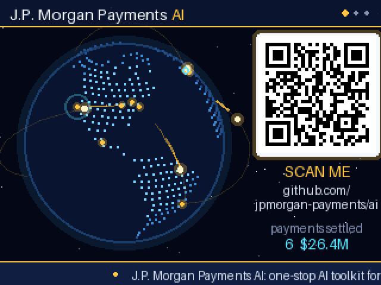
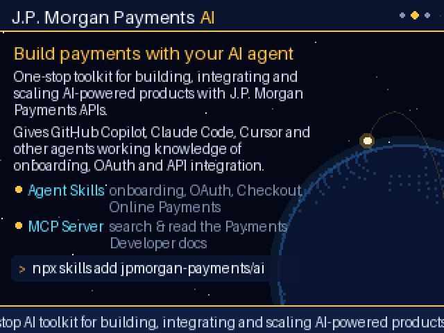
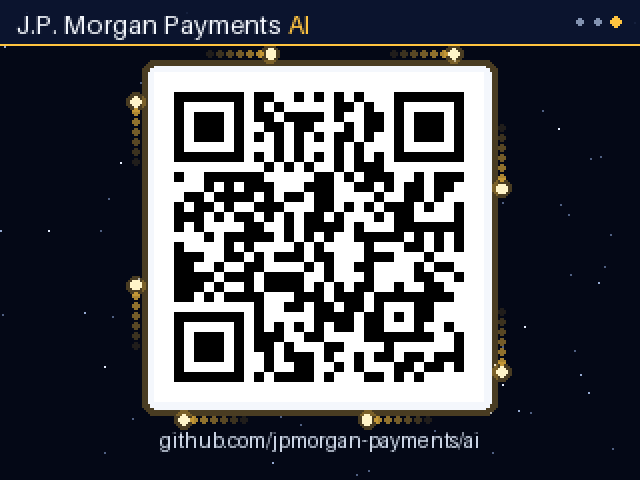

# jpmcai-ghu26-badge

A GitHub Universe 2026 badge app that shows off
[**jpmorgan-payments/ai**](https://github.com/jpmorgan-payments/ai), the
J.P. Morgan Payments AI toolkit for GitHub Copilot and other agents.



The app puts a QR code for the repo next to a dotted globe with payments
flying between the world's financial hubs, a ticker of the repo's description
and landed payments, an About page, and a large QR code page for scanning.

## Install on the badge

The app lives in [`badge/apps/jpm_payments_ai`](badge/apps/jpm_payments_ai)
and targets the 2026 badge firmware ([badger/home](https://github.com/badger/home)).

1. Put the badge in USB mass storage mode (the `/system` volume is read-only
   from the normal REPL).
2. Copy the whole `badge/apps/jpm_payments_ai` folder to `/system/apps/` on
   the badge.
3. Eject and pick **jpm_payments_ai** from the menu.

## Controls

| Control | Action |
| ------- | ------ |
| Left / Right | Globe, About and Scan pages |
| Up / Down | Spin faster or slower |
| Select | Burst of payments out of one hub |

## Development

```bash
pip install segno pillow

# rebuild land dots, QR codes and the icon (world.geo.json is in badger/home
# under badge/assets/)
python tools/build_assets.py path/to/world.geo.json

# render docs/ screenshots and preview.gif with a rough stand-in for the
# firmware (fonts and spacing differ from the real badge)
python tools/preview.py
```

| Globe | About | Scan |
| ----- | ----- | ---- |
|  |  |  |
