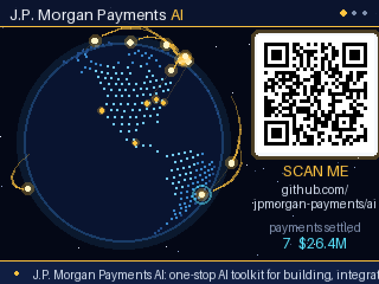

# J.P. Morgan Payments AI

Payments arc around a spinning globe beside a QR code for the J.P. Morgan Payments AI toolkit.

## Usage

The app runs offline: no Wi-Fi or `secrets.py` entries are needed.

| Control | Action |
| ------- | ------ |
| Left / Right | Switch between the Globe, About and Scan pages |
| Up / Down | Spin the globe faster or slower (Down to the end stops it) |
| Select | Fire a burst of payments out of one hub |

- **Globe** — a dotted Earth with gold payments flying between 16 financial
  hubs (New York, London, Singapore, Tokyo, São Paulo, …). Each landing pings
  its hub and joins the ticker along the bottom. The QR code on the right
  opens [github.com/jpmorgan-payments/ai](https://github.com/jpmorgan-payments/ai).
- **About** — what the repo is: Agent Skills and an MCP server that give
  GitHub Copilot, Claude Code, Cursor and other agents working knowledge of the
  J.P. Morgan Payments APIs, plus the one-line install.
- **Scan** — a large QR code for scanning from across a room, with payments
  racing round its frame.

## Assets

`assets/land.bin`, the QR codes and `icon.png` are generated by
`tools/build_assets.py` at the root of this repository.
